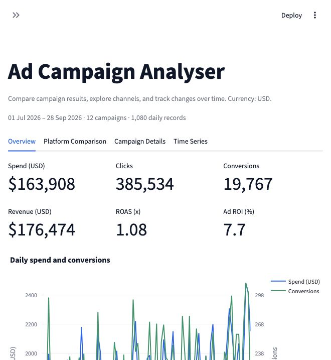

# Ad Campaign Performance Analyzer

A Streamlit dashboard for comparing advertising performance across channels,
campaigns, audiences, and time. Upload a campaign CSV or explore the included
synthetic dataset.



## Features

- **Overview:** spend, clicks, conversions, attributed revenue, ROAS, and ad ROI.
- **Platform comparison:** compare channel totals and efficiency metrics.
- **Campaign details:** search by campaign name or ID and export a summary CSV.
- **Time series:** daily, weekly, and monthly trends by platform.
- **Shared filters:** date range, platform, audience, and campaign goal.
- **Data validation:** clear messages for missing fields, invalid values,
  duplicate records, and inconsistent campaign metadata.

## Quick start

Use Python **3.12**. Run these commands from the repository root:

```bash
python3 -m venv .venv
source .venv/bin/activate
python -m pip install -r requirements.txt
streamlit run app.py
```

On Windows, activate the environment with `.venv\Scripts\activate`.
Open the local URL printed by Streamlit, usually `http://localhost:8501`.

## Repository structure

```text
.
├── app.py                         # Streamlit entry point
├── campaign_analyzer/
│   ├── config.py                  # Schema, labels, and asset paths
│   ├── data.py                    # CSV ingestion and validation
│   ├── metrics.py                 # Totals and efficiency calculations
│   ├── filters.py                 # Shared filters, search, and time aggregation
│   ├── charts.py                  # Plotly figure builders
│   ├── dashboard.py               # Application orchestration
│   └── ui/
│       ├── components.py          # Shared chart/table display
│       └── views.py               # Four dashboard views
├── data/sample_campaign_data.csv  # Fictional example data
├── tests/                        # Unit and Streamlit integration tests
├── docs/                         # Data dictionary, architecture, cohort guide
├── .github/workflows/ci.yml       # Automated lint, format, and test checks
├── .streamlit/config.toml         # Theme and application configuration
├── requirements.txt              # Tested runtime dependency versions
├── requirements-dev.txt          # Runtime and development dependencies
└── pyproject.toml                 # Lint and formatter settings
```

## Dataset and metric definitions

The sample contains **1,080 fictional daily records**, representing 12 campaigns
on Facebook, Instagram, Pinterest, and Twitter from July 1 to September 28,
2026. All monetary amounts use **USD**. Sample results are generated examples,
not evidence about real advertiser or platform performance.

One CSV row must represent one campaign on one day. The required fields are
`date`, `campaign_id`, `campaign_name`, `platform`, `audience`, `campaign_goal`,
`impressions`, `clicks`, `conversions`, `spend`, and `revenue`.
See the [data dictionary](docs/data-dictionary.md) for validation rules.

| Metric | Calculation |
| --- | --- |
| CTR (%) | Clicks / impressions × 100 |
| CVR (%) | Conversions / clicks × 100 |
| CPC (USD) | Spend / clicks |
| CPA (USD) | Spend / conversions |
| ROAS (x) | Attributed revenue / spend |
| Ad ROI (%) | (Attributed revenue − spend) / spend × 100 |

Ratios are calculated from summed numerators and denominators. Zero
denominators yield unavailable values, displayed as N/A, blank cells, or chart
gaps. Ad ROI excludes product and operating costs and is not net profit ROI.
Lead and awareness actions have no assigned revenue in the sample; compare
campaigns with matching goals and audiences.

## Development and verification

```bash
python -m pip install -r requirements-dev.txt
python -m ruff check .
python -m ruff format --check .
python -m unittest discover -s tests -v
```

To apply formatting, run `python -m ruff format .`.
GitHub Actions runs the same checks on pushes and pull requests.
See [CONTRIBUTING.md](CONTRIBUTING.md) and
[architecture notes](docs/architecture.md) before adding features.

## Deployment

The application entry point is `app.py` at the repository root. Install
`requirements.txt` and launch it with `streamlit run app.py`. When using a hosted
Streamlit service, select Python 3.12 and the root-level entry point. Application
paths resolve relative to the repository, so the sample dataset stays portable.

The bundled CSV is public-safe synthetic data. Local virtual environments,
Python caches, `.env` files, Streamlit secrets, and `data/private/` are excluded
from Git. Uploads are processed by the running application and are not written
to disk by this code. CSV uploads to a hosted app are sent to that hosting server.

## Cohort project

This project implements the ad campaign analyzer path. The
[cohort guide](docs/cohort-guide.txt) includes suggested iterations and a demo
outline. Record your actual prompts, screenshots, changes, and learnings for
your submission.
